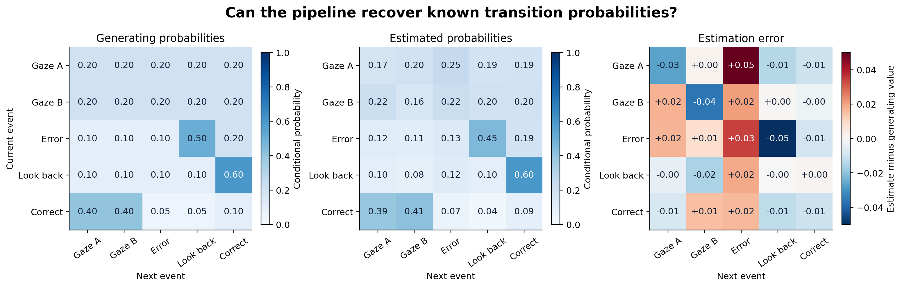
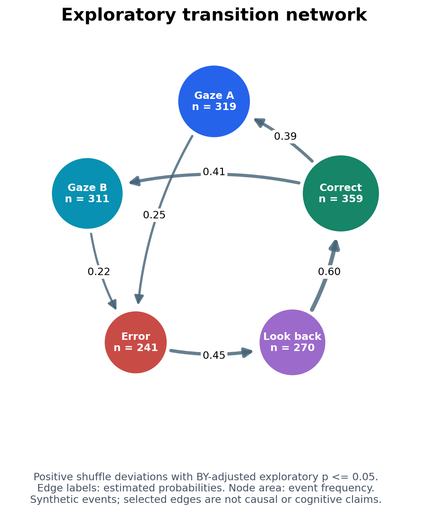
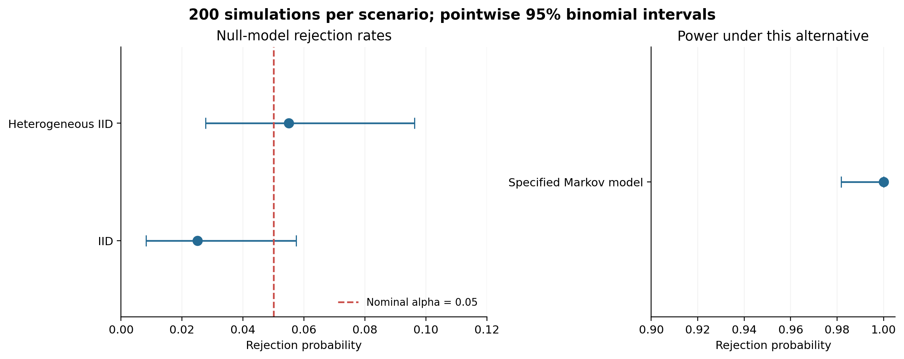
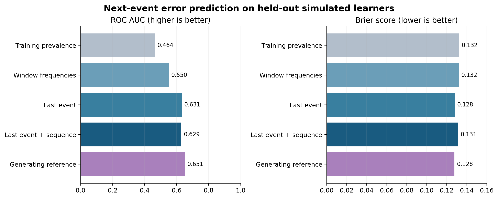

# Learning Behavior Sequence Analysis: A Synthetic Method Validation Study

**Research question:** Can a sequence analysis pipeline recover known temporal structure while keeping learner boundaries, sampling error, and null-model assumptions visible?

This repository generates **synthetic coded events** from a known first-order Markov model. It counts Lag-1 transitions, tests global event-order dependence by shuffling events within learners, checks finite-sample recovery, simulates null rejection rates, and benchmarks next-event prediction on held-out simulated learners. It contains **no real students, recorded gaze coordinates, VR headset logs, cognitive labels, or learning outcomes**. All event labels and probabilities are simulation assumptions.

*Figure 1. The left panel contains the specified generating probabilities; the center contains pooled conditional estimates from 50 simulated learners with 30 events each; the right shows estimate minus truth. The included sample has matrix MAE 0.0161. These values are properties of this simulation, not empirical learning effects.*

## Run the project

Requires Python 3.11 or newer. Verified with Python 3.12.14 and the dependency versions in [requirements.txt](../requirements.txt). From a terminal inside the extracted project folder:

~~~bash
python -m pip install -r requirements.txt
python run_pipeline.py
~~~

The default run generates all data, analyses both datasets, validates recovery, calibrates the global test, fits the predictive baselines, draws figures, and runs the tests. It may take several minutes because it includes 600 calibration datasets, 499 permutations per dataset, and 4,999 permutations in each main analysis. A shorter initial check is available with `python run_pipeline.py --quick`; it overwrites result files with reduced simulation budgets, so rerun the default command before citing the numbers below.

To understand each command in sequence, read [RUNNING_GUIDE.md](RUNNING_GUIDE.md). Python scripts find the project root from their own location.

## What the generator does

There are five mutually exclusive hypothetical event categories: `Gaze_A`, `Gaze_B`, `Error_Op`, `Look_Back`, and `Correct_Op`. The generating matrix specifies, for example, `P(Look_Back | Error_Op) = 0.50` and `P(Correct_Op | Look_Back) = 0.60`. One learner has one session of 30 indexed events. Both the Markov data and an IID baseline start from the generating chain's stationary distribution. The IID baseline independently draws subsequent events from this distribution, giving the same **expected** category frequencies as the Markov sample; actual frequencies differ by sampling noise. Independent random streams are used for the two datasets.

The generated tables each contain 50 × 30 = 1,500 events. Analysis forms exactly 50 × 29 = 1,450 within-learner adjacent transitions. It never joins the end of one learner to the start of another. A row with no outgoing observations has an undefined estimated probability, represented as missing.

The labels suggest a possible application, but do not simulate eye movements, fixation extraction, synchronized hand actions, timestamps, or overlapping data streams. The [data dictionary](DATA_DICTIONARY.md) gives the exact definitions.

## Results from the included full run

| Quantity | Included result |
| --- | ---: |
| Markov global exchangeability permutation p | 0.0002 (minimum resolution for 4,999 permutations) |
| IID baseline global permutation p | 0.2130 (one simulated dataset) |
| Included Markov matrix MAE / RMSE | 0.016128 / 0.021097 |
| Median matrix MAE in 100 independent recovery simulations | 0.017199 |
| 2.5%–97.5% quantiles of the 100 replicate MAEs | 0.011609–0.023555 |
| IID global rejection rate, 200 simulations | 5/200 = 0.025; 95% binomial interval 0.008–0.057 |
| Learner-heterogeneous IID global rejection rate, 200 simulations | 11/200 = 0.055; interval 0.028–0.096 |
| Specified Markov alternative global rejection rate, 200 simulations | 200/200 = 1.000; interval 0.982–1.000 |
| Next-event prediction, last-event-only ROC AUC / Brier | 0.631 / 0.128 |
| Next-event prediction, last-event-plus-sequence ROC AUC / Brier | 0.629 / 0.131 |

Calibration uses 499 permutations per simulation at alpha 0.05. These rates have Monte Carlo uncertainty and concern **only the specified models and the global test**. The 100 recovery MAEs describe sampling variability of the error; their quantiles are not a confidence interval for a real-world transition probability.

*Figure 2. Only positive deviations from shuffled-order expectation with exploratory BY-adjusted p ≤ 0.05 are displayed. Edge labels are observed conditional transition probabilities; node area encodes overall event frequency. The network localizes patterns descriptively under the global exchangeability null; it does not establish valid local tests under partial temporal alternatives, causality, or cognitive interpretation.*

*Figure 3. Rejection rates across 200 independent simulations per scenario; horizontal bars are pointwise 95% binomial intervals. The red dashed line is nominal alpha 0.05. This checks the **global** test under two exchangeable null scenarios and one strong Markov alternative.*

*Figure 4. A five-event observed window predicts whether the immediately following event is Error_Op. Five-fold GroupKFold keeps each learner in either training or test within a fold. The purple generating-probability reference uses the known simulator and is not a fitted or deployable model. Scores are pooled out-of-fold descriptors, with no event-level uncertainty interval.*

The population generator is first-order: once the current event is known, older history cannot add predictive information about the next event. The richer feature model did not improve Brier score in this included sample; the result should not be turned into a claim about real learners. [The fifth figure](../figures/recovery_distribution.png) shows recovery error across 100 simulations. [The offline event explorer](../figures/event_explorer.html) lets you select a learner and move through the observed event prefix; download or extract the HTML file and open it locally in a browser.

## Statistical interpretation

The primary null hypothesis is **exchangeable event order within each learner, conditional on that learner's category counts**. A permutation shuffles each learner's order separately and reconstructs adjacent pairs; the global statistic sums squared departures from the exact conditional expected adjacency counts. The Monte Carlo p-value is `(1 + number of permuted statistics at least as large as observed) / (permutations + 1)`.

Exploratory cell diagnostics include signed count differences, shuffle standard deviations, two-sided permutation tail proportions, and BH/BY adjusted values across all 25 cells. The network uses positive deviations selected by BY. Those cell selections are **not a demonstration of strict cell-level FDR control when other transitions may already exhibit dependence**. Whole-learner bootstrap resampling gives pointwise percentile intervals for pooled transition probabilities, assuming learners are independent. Missing probability rows remain missing.

Recovery validation asks whether estimated probabilities approach known simulation parameters. Significance asks whether order deviates from exchangeability. These are distinct questions. Uniform truth rows have no informative top transition; tied truth maxima are evaluated as a set. See [METHODS.md](METHODS.md) for formulas, assumptions, and limitations.

## Project map

| Path | Role |
| --- | --- |
| `src/generate_data.py` | Generate Markov and IID datasets; save truth and simulation metadata |
| `src/analysis.py` | Learner-safe transitions, global conditional permutation test, exploratory diagnostics, learner bootstrap |
| `src/validate.py` | Truth-versus-estimate error, 100 repeated simulations, tied maxima |
| `src/calibrate.py` | IID, learner-heterogeneous IID, and Markov global-test simulations |
| `src/predict_next_event.py` | Time-respecting features and learner-separated predictive baselines |
| `src/plot_results.py` | Rebuild PNG/SVG figures and the offline explorer |
| `tests/test_pipeline.py` | Behavioral and regression checks |
| `data/` | Included fully synthetic events and generated numerical results |
| `figures/` | Five PNG/SVG figure pairs and one offline HTML explorer |
| `docs/` | Running guide, methods, data dictionary, and advisor fit |

The sample results and generated files are included so a reader can inspect them immediately. The SHA-256 fields in the output summaries support a stale-data check: after regenerating, rerun analysis before validation. The script records versions and seeds; dependency pins and local RNG streams support repetition in a matched environment.

See [the portfolio README](../README.md) for the separate tutoring replay prototype and its research extensions.
